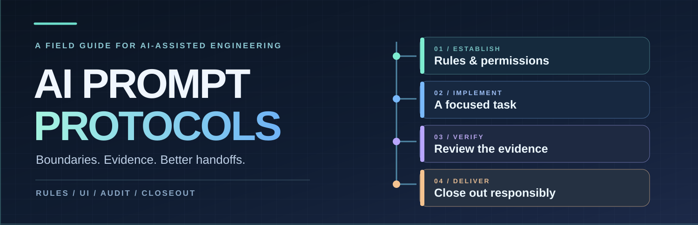

<h1 align="center">🧭 AI Prompt Protocols</h1>

<p align="center">
  
  <br>
  <sub>ORIGINAL VECTOR WORKFLOW ILLUSTRATION · SELECT THE PROTOCOL THAT FITS THE TASK</sub>
</p>

<p align="center">
  <strong>Less improvisation. More reproducible agent work.</strong>
</p>

<p align="center">
  A small, maintained field guide for AI-assisted software development.<br>
  Eleven focused protocols. Clear boundaries. Evidence before confidence.
</p>

<p align="center">
  <a href="#start-with-the-task">🗂️ Find a Protocol</a>
  &nbsp;·&nbsp;
  <a href="#putting-them-together">🔁 Workflow</a>
  &nbsp;·&nbsp;
  <a href="MAINTENANCE.md">⚙️ Maintenance</a>
</p>

<p align="center">
  <sub>GLOBAL RULES &nbsp;·&nbsp; UI FIDELITY &nbsp;·&nbsp; CODE REVIEW &amp; AUDIT &nbsp;·&nbsp; REPOSITORY SETUP &nbsp;·&nbsp; CLOSEOUT &amp; CLEANUP</sub>
</p>

---

> **Choose the smallest protocol that fits the moment.**
>
> This is not a prompt marketplace, a claim of benchmark superiority, or a universal agent framework. The documents are practical instructions refined around real engineering work—not substitutes for reading the repository, testing a change, or obtaining permission for side effects.

## Start with the task

Every document has a job. **Persistent rules establish how an agent works; task protocols guide one phase of the work.** They should not all be pasted into every session.

<table>
  <tr>
    <td width="50%" valign="top">
      <h3>01 / Establish the Rules</h3>
      <p><sub>PERSISTENT AGENT BEHAVIOR</sub></p>
      <p>Keep changes narrow, preserve existing work, and require evidence for claims.</p>
      <p><a href="agent-rules/codex-global-rules.md"><strong>Codex Global Rules →</strong></a><br><a href="agent-rules/claude-code-global-rules.md">Claude Code Global Rules →</a><br><a href="agent-rules/antigravity-global-rules.md">Antigravity Global Rules →</a><br><a href="agent-rules/universal-coding-agent-global-rules.md">Universal Coding Agent Rules →</a></p>
    </td>
    <td width="50%" valign="top">
      <h3>02 / Make the Interface Match</h3>
      <p><sub>DESIGN EVIDENCE → REAL RENDER</sub></p>
      <p>Extract a faithful UI specification, then refine the actual implementation against its reference.</p>
      <p><a href="ui-workflows/ui-screenshot-to-implementation-spec.md"><strong>Screenshot → Spec →</strong></a><br><a href="ui-workflows/ui-visual-fidelity-refinement.md">Visual Fidelity Refinement →</a></p>
    </td>
  </tr>
  <tr>
    <td width="50%" valign="top">
      <h3>03 / Establish Confidence</h3>
      <p><sub>REAL REPOSITORY · ACTIONABLE FINDINGS</sub></p>
      <p>Build project-specific instructions from verified facts; review changes or audit a whole repository without inventing defects.</p>
      <p><a href="init-workflows/universal-agent-init.md"><strong>Universal Agent Init →</strong></a><br><a href="review-workflows/unified-code-review-and-repository-audit.md">Unified Code Review &amp; Repository Audit →</a></p>
    </td>
    <td width="50%" valign="top">
      <h3>04 / Finish Without Losing Work</h3>
      <p><sub>VALIDATION · DIFF · AUTHORIZATION</sub></p>
      <p>Finish verified work, deliver confirmed repairs, or audit local cleanup candidates before recycling only user-selected items.</p>
      <p><a href="project-workflows/project-closeout.md"><strong>Project Closeout →</strong></a><br><a href="project-workflows/repository-audit-repair-closeout.md">Audit, Repair &amp; Closeout →</a><br><a href="project-workflows/local-recycle-bin-cleanup.md">Local Recycle Bin Cleanup →</a></p>
    </td>
  </tr>
</table>

| Task | Recommended starting point | When |
| --- | --- | --- |
| Predictable Codex sessions | [Codex Global Rules](agent-rules/codex-global-rules.md) | Persistent Codex instructions (`~/.codex/AGENTS.md`) |
| Predictable Claude Code sessions | [Claude Code Global Rules](agent-rules/claude-code-global-rules.md) | Persistent Claude Code instructions (`~/.claude/CLAUDE.md`) |
| Predictable Antigravity (Gemini) sessions | [Antigravity Global Rules](agent-rules/antigravity-global-rules.md) | Persistent Antigravity instructions (`~/.gemini/config/GEMINI.md`) |
| Consistent cross-agent behavior | [Universal Coding Agent Global Rules](agent-rules/universal-coding-agent-global-rules.md) | Persistent, tool-independent instructions |
| Interpret a screenshot | [UI Screenshot → Implementation Spec](ui-workflows/ui-screenshot-to-implementation-spec.md) | Before implementation |
| Match a reference image | [UI Visual Fidelity Refinement](ui-workflows/ui-visual-fidelity-refinement.md) | After a working first render |
| Finish a scoped task | [Project Closeout](project-workflows/project-closeout.md) | After verification and diff review |
| Review a change, a scope, or a whole repository | [Unified Code Review & Repository Audit](review-workflows/unified-code-review-and-repository-audit.md) | Before merging, or as an audit-only health check |
| Set up repository guidance | [Universal Agent Init](init-workflows/universal-agent-init.md) | On project adoption or instruction audit |
| Audit, repair, and deliver a repository | [Repository Audit, Repair & Closeout](project-workflows/repository-audit-repair-closeout.md) | Explicitly authorized execution and Git delivery |
| Review local cleanup candidates | [Local Recycle Bin Cleanup](project-workflows/local-recycle-bin-cleanup.md) | Read-only audit, then user-selected recycling |

## Protocols in context

The files linked below are the **authoritative prompts**. This README is the map—not a second, abbreviated copy to give an agent instead of the real document.

Navigation and explanations are in English. Prompts are presented in their original language; no translated copy is required.

### Codex Global Rules

**Use when:** a Codex session needs stable expectations around scope, edits, testing, browser-automation routing, and external actions. It emphasizes the smallest safe change, preservation of existing work, proportionate checks, and accurate completion reports.

**Read:** [English source](agent-rules/codex-global-rules.md)

### Claude Code Global Rules

**Use when:** Claude Code needs the same persistent expectations as Codex. The content is identical to the Codex rules apart from the title (including browser-automation routing), so one rule set can be maintained across both agents.

**Read:** [English source](agent-rules/claude-code-global-rules.md)

### Antigravity Global Rules

**Use when:** an Antigravity (Gemini) session needs the same engineering discipline in a more compact, Gemini-oriented form. It maps repository instructions to `GEMINI.md`, `AGENTS.md`, and `.agents/`, guards subagent/workflow/swarm invocation and Antigravity permission settings, and includes browser-automation routing.

**Read:** [English source](agent-rules/antigravity-global-rules.md)

### Universal Coding Agent Global Rules

**Use when:** the same working principles must survive a change of coding assistant. The rules avoid assuming one tool interface or specific browser-automation tools, while retaining explicit boundaries for destructive operations, repository state, and permission to act.

**Read:** [English source](agent-rules/universal-coding-agent-global-rules.md)

### UI Screenshot → Implementation Spec Protocol

**Use before coding.** Translate supplied screenshots into a specification that another agent can implement. Separate what is visible from what is only estimated or inferred; document the layout relationships and the gaps that the reference cannot prove.

**Output:** a grounded implementation specification, **not** generated UI code.

**Read:** [Source protocol](ui-workflows/ui-screenshot-to-implementation-spec.md)

### UI Visual Fidelity Refinement Protocol

**Use after the first real render.** Compare the rendered page with its reference, prioritize meaningful mismatches, find their causes, then edit a coherent cluster and render again.

```text
Reference + current render
            ↓
       Compare the evidence
            ↓
     Fix a meaningful cause
            ↓
   Render again → keep / revise / revert
```

If a browser or screenshot comparison is unavailable, the protocol requires **an explicit verification limitation**, not a claim of visual success.

**Read:** [Source protocol](ui-workflows/ui-visual-fidelity-refinement.md)

### Project Closeout Prompt

**Use only when explicitly invoked.** This Chinese-language protocol distinguishes ordinary status checks from an authorized request to finish and integrate work. It reviews changes and validation before proceeding with permitted Git operations; destructive or production-affecting actions require their own approval.

**Read:** [Chinese canonical source](project-workflows/project-closeout.md)

### Unified Code Review & Repository Audit

**Use before accepting a change, or for an audit-only health check.** This Chinese-language protocol selects CHANGE (a PR, diff, or commit range), REPOSITORY (a whole-repository audit), or FOCUSED (specified files or modules) mode automatically. It pins a baseline, separates confirmed findings from those that still need verification, and hands off repair guidance; zero invented findings is better than a long speculative report.

**Boundary:** audit only by default. It does not repair code, create commits or PRs, push, or deploy.

**Read:** [Chinese canonical source](review-workflows/unified-code-review-and-repository-audit.md)

### Universal Agent Init

**Use when adopting or auditing a repository.** Inspect the actual source, commands, tests, and existing instructions before updating `AGENTS.md` or `CLAUDE.md`. Preserve valuable guidance and user changes instead of pasting a generic template.

**Read:** [Source protocol](init-workflows/universal-agent-init.md)

### Repository Audit, Repair & Closeout

**Use only when explicitly authorizing an agent to take over the current repository.** This execution protocol adds confirmed repairs, regression checks, commits, remote delivery, and final workspace verification to a full audit. It preserves pre-existing work and distinguishes code synchronization from production release.

**Authorization:** explicit invocation includes pushing to the verified existing remote and, where permitted and all review gates are satisfied, PR integration. Read its scope before invoking it; adding it to this library does not execute it.

**Read:** [Chinese canonical source](project-workflows/repository-audit-repair-closeout.md)

### Local Recycle Bin Cleanup

**Use when local project files or disk usage need an informed cleanup decision.** The agent first audits a specified scope and explains each candidate's purpose, size, consequences, and recovery conditions. Only candidates selected by the user may then be moved to the system recycle bin after a fresh boundary check.

**Safety boundary:** no permanent deletion or emptying the recycle bin. Moving files to the recycle bin is not proof of freed disk space. Requires access to the actual host files and a supported system recycling mechanism.

**Read:** [Chinese canonical source](project-workflows/local-recycle-bin-cleanup.md)

## Putting them together

```text
Global behavior rules
        ↓
Repository facts and existing instructions
        ↓
One task-specific protocol, when appropriate
        ↓
Implement or inspect
        ↓
Verify evidence and review the diff
        ↓
Authorized closeout
```

**Example paths:** *Screenshot → Spec → Implementation → Fidelity Refinement.* Or *Change → Unified Review (CHANGE mode) → Verified Closeout.* The protocols complement real project instructions; they never override explicit permissions or facts on disk.

## How to use a protocol

1. **Open the canonical Markdown file.** Each phase protocol is designed to stand alone; this index cannot replace it.
2. **Place it in the right context.** Global rules may belong in persistent instructions; a review or visual-refinement protocol is for the relevant task.
3. **Check your agent's conventions.** Automatic loading of `AGENTS.md`, `CLAUDE.md`, and other instruction files depends on the tool, not on a universal standard.
4. **Verify the outcome yourself.** A disciplined prompt does not guarantee correct code, an accurate review, or a matching visual result.

## File map

```text
agent-rules/          Codex, Claude Code, Antigravity, and universal persistent rules
ui-workflows/         Screenshot specification and visual refinement
project-workflows/    Task closeout, audit-to-repair delivery, and local cleanup
review-workflows/     Unified code review and repository audit
init-workflows/       AGENTS.md / CLAUDE.md initialization
README.md            English navigation and protocol showcase
MAINTENANCE.md       Prompt lifecycle and language policy
```

## Contributing

The most valuable improvement is **a specific, reproducible failure or a verified correction**. Document the context, why the protocol was insufficient, and the smallest change that solves it. Keep source files authoritative and the English README accurate.

See [MAINTENANCE.md](MAINTENANCE.md) for canonical-versus-derived content, language policy, stable paths, and review requirements. Avoid speculative prompt expansion, duplicate `-v2` files, and claims of universal effectiveness.

## License

Released under the **[MIT License](LICENSE)**. This is a small, plain-text protocol library—no application, build system, or installation step is required.

---

<p align="center"><sub>LESS IMPROVISATION. MORE EVIDENCE. WORK THAT CAN BE REVIEWED.</sub></p>
