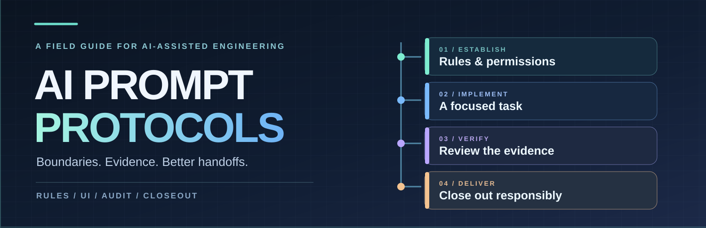

# AI Prompt Protocols

A practical library of prompts and working rules for AI-assisted software development. Choose the document that fits the task, read its full instructions, and verify the result against the actual repository.

[Choose a protocol](#choose-a-protocol) · [How to use one](#how-to-use-a-protocol) · [Maintenance](MAINTENANCE.md)

*Original illustration of the workflow; it is not an application screenshot.*

## Choose a protocol

**Establish working boundaries**

- [Codex Global Rules](agent-rules/codex-global-rules.md) and [Universal Coding Agent Global Rules](agent-rules/universal-coding-agent-global-rules.md) set persistent expectations for scope, evidence, existing work, and side effects. Optional Chinese translations are available for [Codex](translations/zh-CN/agent-rules/codex-global-rules.md) and [universal rules](translations/zh-CN/agent-rules/universal-coding-agent-global-rules.md).
- [Universal Agent Init](init-workflows/universal-agent-init.md) derives repository guidance from inspected files, commands, and existing instructions.

**Work from a visual reference**

- [UI Screenshot → Implementation Spec](ui-workflows/ui-screenshot-to-implementation-spec.md) turns a screenshot into a grounded specification before implementation.
- [UI Visual Fidelity Refinement](ui-workflows/ui-visual-fidelity-refinement.md) compares a real render with its reference, fixes meaningful differences, and checks again.

**Review or finish a task**

- [Expert Code Review](review-workflows/expert-code-review.md) focuses on actionable findings supported by evidence.
- [Repository Audit](review-workflows/repository-audit.md) is an independent whole-repository investigation, without automatically authorizing repairs or remote changes. The canonical prompt is in Chinese.
- [Project Closeout](project-workflows/project-closeout.md) guides explicitly invoked task closeout. The canonical prompt is in Chinese.
- [Repository Audit, Repair & Closeout](project-workflows/repository-audit-repair-closeout.md) adds authorized repair and delivery to an audit. Its explicit invocation includes the Git delivery described in that prompt; read its scope before using it. The canonical prompt is in Chinese.
- [Local Recycle Bin Cleanup](project-workflows/local-recycle-bin-cleanup.md) audits a specified scope and moves only user-selected candidates to the recycle bin after rechecking them. It does not authorize permanent deletion or emptying the bin. The canonical prompt is in Chinese.

## How to use a protocol

1. Open the linked canonical Markdown file; this README is a map, not a substitute for the full prompt.
2. Give the document to a compatible agent in the context of the relevant task. Persistent rules and one-off task protocols serve different purposes.
3. Check the agent's own instruction-loading conventions and the repository's current guidance.
4. Review the actual work, evidence, and permission boundaries. A prompt cannot guarantee correct code, a complete audit, or a visually faithful result.

The prompts retain their original language. A non-global protocol is intended to stand on its own without a personal knowledge vault, local machine path, or another project.

## Repository map

| Path | Contents |
| --- | --- |
| [`agent-rules/`](agent-rules/) | Persistent Codex and tool-independent rules |
| [`ui-workflows/`](ui-workflows/) | Screenshot specification and visual refinement |
| [`review-workflows/`](review-workflows/) | Code review and independent repository audit |
| [`project-workflows/`](project-workflows/) | Closeout, audit-to-repair, and selected cleanup |
| [`init-workflows/`](init-workflows/) | Repository instruction initialization |
| [`translations/zh-CN/`](translations/zh-CN/) | Optional translations of the two global rules |

This is a plain-text library; there is no application to install, build, or run.

## Contributing

Bring a specific reproducible failure or correction, explain the context, and keep the canonical document authoritative. [Maintenance](MAINTENANCE.md) covers prompt lifecycle, language policy, stable paths, and review. Existing prompt translations are preserved but are not automatically synchronized.

## License

The repository is released under the [MIT License](LICENSE).
